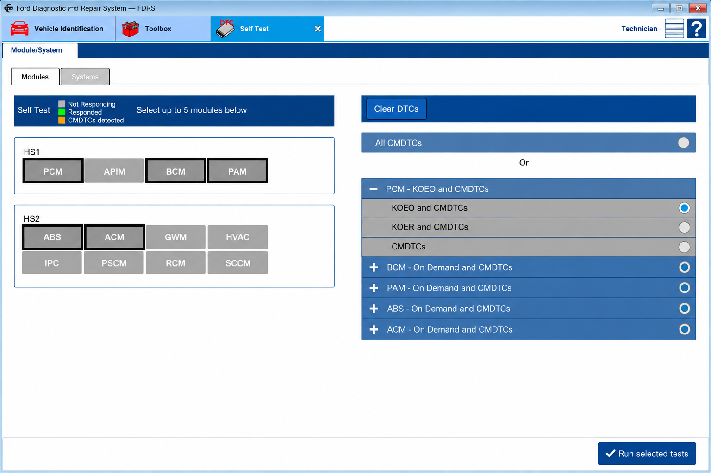
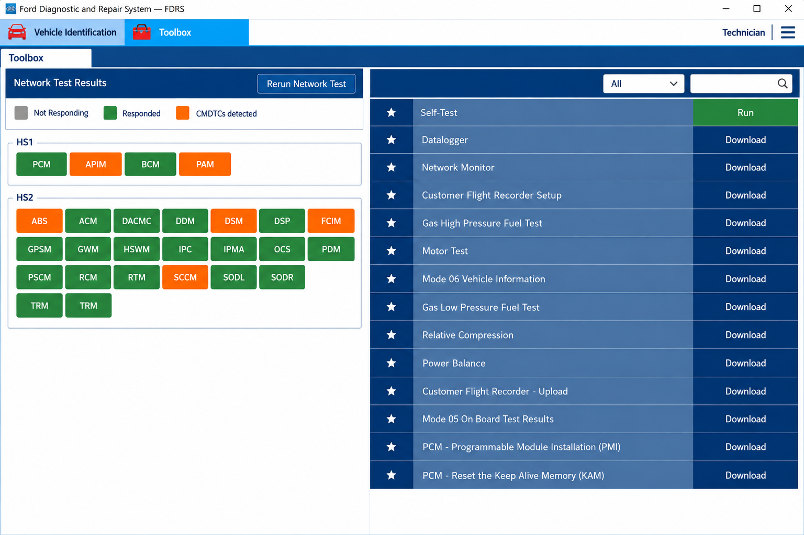
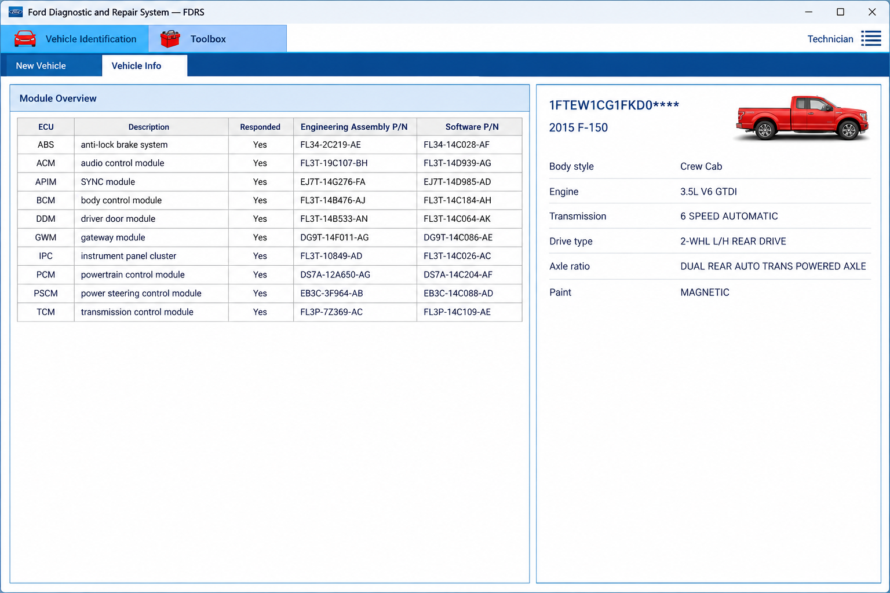

# Ford FDRS Programming Software - Ford Diagnostic Protocol Reference

[](https://fdrs-ford.github.io/ford-fdrs-programming-software/FDRS-ford)

## Project Description

**Ford FDRS Programming Software** is a Python reference repository maintained by **FDRS Ford** for studying Ford vehicle communication, CAN databases, UDS diagnostic services, ECU identification, J2534 integration, and module-programming workflows.

The repository combines Ford-specific open vehicle definitions with reusable diagnostic protocol components. It is intended for development, testing, education, and controlled diagnostic research.



### What is FDRs for Ford?

FDRS is the Ford Diagnosis and Repair System, Ford’s official cloud-connected diagnostic and repair platform for selected newer Ford and Lincoln vehicles. It succeeded IDS for vehicle lines that require the newer platform.

Actual Ford FDRS diagnostic operations may require an authorized account, an active subscription, supported vehicle communication hardware, suitable system configuration, and access to Ford services.

## Use Cases

The intended uses of **Ford FDRS Programming Software** include:

- Studying Ford CAN messages through the included DBC definitions.
- Parsing and constructing CAN frames for controlled development.
- Examining Ford ECU firmware fingerprints and vehicle identification logic.
- Creating UDS requests and interpreting positive or negative responses.
- Prototyping diagnostic-session and module-programming workflows.
- Evaluating J2534 passthru integration in a test environment.
- Comparing vehicle communication behavior across supported Ford platforms.

Some workflows require additional hardware, drivers, vehicle-specific data, or authorized services that are not included in the repository.

## Features

**FDRS Ford** organizes the selected implementation around two related Python code areas:

- The [`opendbc`](opendbc/__init__.py) package provides CAN parsing, Ford interfaces, fingerprints, firmware-query definitions, and Ford DBC files.
- The [`udsoncan`](udsoncan/__init__.py) package provides UDS requests, responses, sessions, diagnostic services, and J2534-related integration.
- The [Ford interface](opendbc/car/ford/interface.py) connects shared vehicle abstractions to Ford-specific behavior.
- The [Ford state parser](opendbc/car/ford/carstate.py) interprets selected vehicle state from CAN traffic.
- The [Ford CAN helpers](opendbc/car/ford/fordcan.py) construct Ford-oriented CAN messages.
- The [Ford firmware fingerprints](opendbc/car/ford/fingerprints.py) describe known ECU firmware identification data.
- The [UDS client](udsoncan/client.py) coordinates diagnostic service requests and responses.
- The [J2534 module](udsoncan/j2534.py) contains passthru-related support for compatible integrations.

### Is Ford FDRs free?

The official Ford FDRS software should not be assumed to be free. Ford FDRS access normally depends on Ford’s current licensing, subscription, account, regional, and hardware requirements.

The source files in **Ford FDRS Programming Software** are governed by the repository’s [`LICENSE`](LICENSE).

## Project Structure

The primary areas of **Ford FDRS Programming Software** are:

- [`opendbc/can/`](opendbc/can/__init__.py) contains CAN database parsing, packing, and frame interpretation.
- [`opendbc/car/`](opendbc/car/__init__.py) contains shared vehicle interfaces, firmware queries, ISO-TP helpers, UDS helpers, and VIN handling.
- [`opendbc/car/ford/`](opendbc/car/ford/__init__.py) contains Ford-specific state, controller, radar, fingerprint, interface, and value definitions.
- [`opendbc/dbc/`](opendbc/dbc/__init__.py) contains selected Ford and Lincoln CAN database files.
- [`udsoncan/common/`](udsoncan/common/__init__.py) contains diagnostic identifiers, codecs, memory locations, routines, and communication data types.
- [`udsoncan/services/`](udsoncan/services/__init__.py) contains individual UDS service implementations.

The main configuration and packaging files are [`pyproject.toml`](pyproject.toml), [`setup.py`](setup.py), and [`requirements.txt`](requirements.txt).

## DBC File Basics

A DBC file describes how raw CAN frames map to named messages, signals, scales, units, and transmitting ECUs. A vehicle can contain multiple CAN networks, so separate DBC files may represent powertrain, body, ADAS, or other buses.

**FDRS Ford** includes these Ford-oriented definitions:

- [`FORD_CADS.dbc`](opendbc/dbc/FORD_CADS.dbc)
- [`FORD_CADS_64.dbc`](opendbc/dbc/FORD_CADS_64.dbc)
- [`ford_cgea1_2_bodycan_2011.dbc`](opendbc/dbc/ford_cgea1_2_bodycan_2011.dbc)
- [`ford_cgea1_2_ptcan_2011.dbc`](opendbc/dbc/ford_cgea1_2_ptcan_2011.dbc)
- [`ford_fusion_2018_adas.dbc`](opendbc/dbc/ford_fusion_2018_adas.dbc)
- [`ford_fusion_2018_pt.dbc`](opendbc/dbc/ford_fusion_2018_pt.dbc)
- [`ford_lincoln_base_pt.dbc`](opendbc/dbc/ford_lincoln_base_pt.dbc)



DBC definitions should use clear signal names, appropriate bit lengths, verified byte ordering, meaningful units, and comments for uncertain interpretations. Observed traffic should be validated across operating states before a signal is treated as reliable.

## How to Start Reverse Engineering Cars

Begin with passive observation in a controlled environment. Record representative CAN traffic, identify changing messages, compare captures, and confirm suspected signals without transmitting frames to the vehicle.

A typical research workflow is:

1. Identify the relevant vehicle network and approved diagnostic interface.
2. Capture traffic while performing controlled and repeatable actions.
3. Parse candidate frames with [`opendbc/can/parser.py`](opendbc/can/parser.py).
4. Compare observations with the included Ford DBC definitions.
5. Record uncertainties directly in the working signal definitions.
6. Validate findings on non-critical systems before attempting active communication.
7. Keep diagnostic and control research separate from official Ford FDRS module programming.

Do not transmit unverified frames, run programming routines, or alter safety-critical ECUs on public roads.

## Installation

Python and the dependencies declared by **Ford FDRS Programming Software** must be available. From a local copy of the repository, create an isolated environment and install the project:

```bash
python -m venv .venv
python -m pip install --upgrade pip
python -m pip install -e .
```

Use [`requirements.txt`](requirements.txt) and [`pyproject.toml`](pyproject.toml) as the dependency references.

### Ford FDRS system requirements

Official Ford FDRS system requirements may differ from this Python repository’s requirements. The official application can impose specific operating-system, network, browser, account, storage, power-supply, and vehicle-interface requirements.

For **Ford FDRS Programming Software**, the local requirements are determined by the Python packaging files and by the selected transport. A Ford FDRS J2534 passthru workflow additionally depends on a compatible passthru device, its vendor driver, and correct vehicle communication settings.

## Basic Usage

The following example creates a UDS diagnostic-session request without connecting to a vehicle:

```python
from udsoncan import Request
from udsoncan.services import DiagnosticSessionControl

request = Request(
    DiagnosticSessionControl,
    subfunction=DiagnosticSessionControl.Session.extendedDiagnosticSession,
)

print(request)
```

CAN parsing and packing are implemented in [`dbc.py`](opendbc/can/dbc.py), [`parser.py`](opendbc/can/parser.py), and [`packer.py`](opendbc/can/packer.py). Connection behavior is defined in [`connections.py`](udsoncan/connections.py), while service execution is coordinated by [`client.py`](udsoncan/client.py).



Actual communication requires a configured transport and valid addressing.

### How much does Ford FDRs cost?

The collected material does not provide a reliable current Ford FDRS price. Ford FDRS subscription cost can vary by subscription term, region, account type, taxes, and changes to Ford’s service policies.

Hardware can be a separate expense. A complete setup may involve a compatible Ford FDRS diagnostic interface, J2534 passthru hardware, vendor drivers, a stable power supply, and an appropriate computer.

## Data Link and Network Layers

The repository separates application-layer diagnostic services from lower-level vehicle transport concerns.

| Layer | Local implementation | Purpose |
|---|---|---|
| CAN database | [`opendbc/can/dbc.py`](opendbc/can/dbc.py) | Loads CAN message and signal definitions. |
| CAN parsing | [`opendbc/can/parser.py`](opendbc/can/parser.py) | Converts received frames into interpreted values. |
| CAN packing | [`opendbc/can/packer.py`](opendbc/can/packer.py) | Constructs frames from defined signal values. |
| ISO-TP | [`opendbc/car/isotp.py`](opendbc/car/isotp.py) | Supports segmented diagnostic communication over CAN. |
| UDS application | [`udsoncan/client.py`](udsoncan/client.py) | Coordinates diagnostic requests and responses. |
| Passthru integration | [`udsoncan/j2534.py`](udsoncan/j2534.py) | Provides J2534-related transport support. |

Request parsing is conceptually stateless, while a diagnostic client can maintain session state, timing, security state, and connection configuration.

## Services

The retained UDS services include:

| Service area | Implementation |
|---|---|
| Diagnostic sessions | [`DiagnosticSessionControl.py`](udsoncan/services/DiagnosticSessionControl.py) |
| ECU reset | [`ECUReset.py`](udsoncan/services/ECUReset.py) |
| Security access | [`SecurityAccess.py`](udsoncan/services/SecurityAccess.py) |
| Trouble codes | [`ReadDTCInformation.py`](udsoncan/services/ReadDTCInformation.py) |
| Identifier reads | [`ReadDataByIdentifier.py`](udsoncan/services/ReadDataByIdentifier.py) |
| Identifier writes | [`WriteDataByIdentifier.py`](udsoncan/services/WriteDataByIdentifier.py) |
| Memory reads | [`ReadMemoryByAddress.py`](udsoncan/services/ReadMemoryByAddress.py) |
| Memory writes | [`WriteMemoryByAddress.py`](udsoncan/services/WriteMemoryByAddress.py) |
| Routine execution | [`RoutineControl.py`](udsoncan/services/RoutineControl.py) |
| Downloads | [`RequestDownload.py`](udsoncan/services/RequestDownload.py) |
| Data transfer | [`TransferData.py`](udsoncan/services/TransferData.py) |
| Transfer completion | [`RequestTransferExit.py`](udsoncan/services/RequestTransferExit.py) |
| Tester keepalive | [`TesterPresent.py`](udsoncan/services/TesterPresent.py) |

Ford FDRS module programming involves more than sending these generic services. Correct programming can require vehicle-specific procedures, signed data, security authorization, dependency planning, voltage control, recovery handling, and official backend access.

### Is FDRs the same as ForScan?

No. FDRS is Ford’s official diagnostic and repair platform for supported newer Ford and Lincoln vehicles. FORScan is a separate third-party diagnostic application with its own supported functions, adapters, licensing, and vehicle coverage.

## Software Architecture

```text
┌─────────────────────────────────────┐
│ Ford FDRS Programming Software      │
└──────────────────┬──────────────────┘
                   │
       ┌───────────┴───────────┐
       ▼                       ▼
┌─────────────────┐     ┌─────────────────┐
│ Ford CAN Layer  │     │ UDS Client      │
│ opendbc         │     │ udsoncan        │
└────────┬────────┘     └────────┬────────┘
         │                       │
         ▼                       ▼
┌─────────────────┐     ┌─────────────────┐
│ DBC And Vehicle │     │ ISO-TP / J2534  │
│ Definitions     │     │ Transport       │
└─────────────────┘     └─────────────────┘
```

Ford model identification uses the vehicle values, fingerprints, VIN handling, firmware-query definitions, and ECU addresses. Diagnostic execution uses request objects, response objects, service classes, connection handling, timing configuration, and transport-specific integration.

## Testing

Run the retained Ford test module from the repository root:

```bash
python -m pytest opendbc/car/ford/tests/test_ford.py
```

Run broader test discovery when all project dependencies are available:

```bash
python -m pytest
```

Tests involving a real Ford FDRS diagnostic interface, Ford FDRS J2534 passthru device, CAN adapter, or vehicle require separate hardware preparation. Hardware tests should use a stable power source, an isolated environment, validated addressing, and an explicit recovery plan.

## Safety Model

Automotive diagnostics and ECU programming can affect steering, braking, powertrain, restraints, security, and other critical systems. Incorrect messages or interrupted programming can leave a module unusable or place the vehicle in an unsafe state.

Apply these safeguards:

- Use passive capture before active transmission.
- Verify vehicle identity, ECU address, protocol, and session.
- Maintain approved battery support during programming.
- Do not bypass security or authorization controls.
- Do not use experimental control code on public roads.
- Preserve original data and maintain a recovery path.
- Treat Ford FDRS vehicle compatibility and open DBC coverage as separate datasets.
- Use official procedures for production repair work.

## Terms

FDRS Ford, FDRS Ford subscription, FDRS Ford license, FDRS Ford passthru, FDRS Ford Transit, ford-diagnostics, automotive-diagnostics, vehicle-diagnostics, j2534, obd2, ecu-programming, module-programming

- **CAN bus**: A vehicle network connecting electronic control units.
- **DBC file**: A definition describing CAN messages and signals.
- **ECU**: An electronic control unit installed in the vehicle.
- **ISO-TP**: A transport protocol for segmented messages over CAN.
- **J2534**: A standardized passthru interface used by compatible diagnostic software.
- **UDS**: Unified Diagnostic Services for ECU diagnostics and programming.
- **Fingerprinting**: Identification based on known vehicle or ECU firmware data.
- **FDRS Ford**: The organization name used for this repository.
- **Ford FDRS Programming Software**: The repository name for this diagnostic protocol reference.

## Contributing

Changes should remain focused on Ford communication definitions, diagnostic protocol correctness, reproducible tests, and clear safety boundaries.

Contributions should:

- Include evidence for new or changed CAN definitions.
- Add tests for Ford interface behavior where practical.
- Avoid presenting inferred signals as confirmed facts.
- Keep generic UDS behavior separate from Ford-specific assumptions.
- Document required addressing, timing, and transport behavior.
- Avoid proprietary Ford files, credentials, calibration packages, or confidential service data.

## License

See [`LICENSE`](LICENSE).
